<div align="center">

<!-- ========================================================================= -->
<!-- HERO BANNER (Animated Cyberpunk SVG Header with Floating 3D Tiles)     -->
<!-- ========================================================================= -->
<a href="https://github.com/Cell1991/crossword-game">
  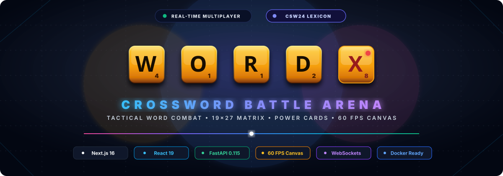
</a>

<br/><br/>

<!-- ========================================================================= -->
<!-- TECHNOLOGIES & STATUS BADGES MATRIX (Technologies & Status)               -->
<!-- ========================================================================= -->
[](https://nextjs.org/)
[](https://react.dev/)
[](https://fastapi.tiangolo.com/)
[](https://python.org/)
[](https://www.postgresql.org/)
[](https://www.sqlite.org/)
[](https://tailwindcss.com/)
[](https://developer.mozilla.org/en-US/docs/Web/API/Canvas_API)
[](https://developer.mozilla.org/en-US/docs/Web/API/WebSockets_API)
[](https://www.docker.com/)
[](LICENSE)

<br/>

**A next-generation real-time multiplayer Crossword combat battleground fusing competitive word-building mechanics with RPG health elimination, 7 tactical Power Cards, autonomous AI bot opponents, a 3-tier dictionary engine with Grimoire anagram spellbook, and a 60 FPS HTML5 Canvas compositor.**

<br/>

<!-- ========================================================================= -->
<!-- TACTICAL NAVIGATION RADAR & SITEMAP MATRIX                            -->
<!-- ========================================================================= -->
<a href="https://github.com/Cell1991/crossword-game">
  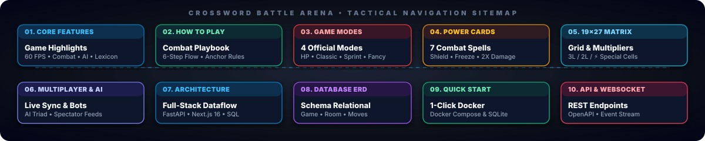
</a>

<br/><br/>

<p align="center">
  <a href="#bento-grid-feature-matrix">
    
  </a>
  <a href="#how-to-play-master-combat-playbook">
    
  </a>
  <a href="#game-modes--ruleset-arbitration">
    
  </a>
  <a href="#tactical-power-card-deck">
    
  </a>
  <a href="#19x27-modular-matrix--special-squares">
    
  </a>
</p>

<p align="center">
  <a href="#real-time-multiplayer-ai-bots--spectating">
    
  </a>
  <a href="#system-architecture">
    
  </a>
  <a href="#database-entity-relationship-model">
    
  </a>
  <a href="#quick-start--installation">
    
  </a>
  <a href="#api--websocket-specification">
    
  </a>
</p>

</div>

<br/>

---

## Bento Grid Feature Matrix

<br/>

<!-- Animated Bento Grid SVG Diagram -->
<div align="center">
  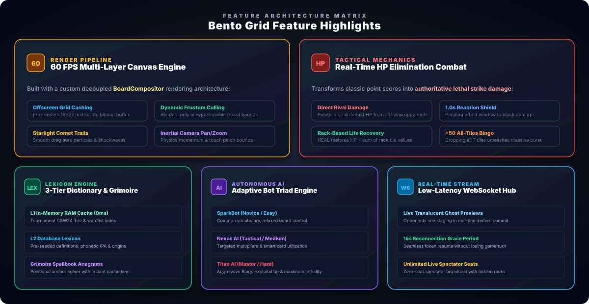
</div>

<br/>

### Core Feature Capabilities

- **60 FPS Hardware-Accelerated Canvas Engine**  
  **Implementation:** Custom `BoardCompositor` with offscreen double-buffered bitmap caching, dynamic frustum viewport culling, inertial camera pan/zoom gestures, and comet particle trails (`FXRenderer`).  
  **Strategic Impact:** Butter-smooth 60 FPS rendering on high-DPI desktop and mobile devices, eliminating DOM re-render lag across the expansive $19 \times 27$ grid (513 cells).

- **Real-Time HP Elimination Combat**  
  **Implementation:** Word points convert authoritatively into lethal damage dealt to living rivals. Features a 1.0-second reactive `SHIELD` reaction window, rack-based `HEAL`, and spectator demotion at 0 HP.  
  **Strategic Impact:** Replaces passive word puzzles with high-intensity elimination combat where defensive timing and offensive burst damage decide victory.

- **3-Tier Dictionary Engine & Grimoire Spellbook**  
  **Implementation:** In-memory **CSW24 Tournament Lexicon** (`wordlist.txt`), multi-tier definition cache (**L1 RAM** &rarr; **L2 Database** &rarr; **L3 Async Online API**), and positional anagram word solver (`grimoire.py`).  
  **Strategic Impact:** Sub-millisecond orthogonal validation with rich English definitions, phonetic IPA transcriptions, and instant AI word generation.

- **Autonomous AI Bot Opponents (3 Tiers)**  
  **Implementation:** 3 distinct difficulty profiles (**SparkBot / Easy**, **Nexus AI / Medium**, **Titan AI / Hard**) driven by heuristic candidate solvers and auto-scheduled turn executors (`bot_service.py`).  
  **Strategic Impact:** Enables solo practice anytime or automatically fills vacant lobby seats with believable, competitive tactical opponents.

- **Zero-Latency WebSocket Stream**  
  **Implementation:** Persistent bidirectional WebSocket connection (`/ws/games/{id}`) broadcasting turn clocks, translucent placement ghosts, card shockwaves, spectator feeds, and 15-second reconnection grace.  
  **Strategic Impact:** Sub-second multiplayer synchronization allowing players to watch opponents stage tiles live before committing.

- **Dynamic Sound Effects & Audio FX**  
  **Implementation:** Web Audio API synthesized procedural SFX, ambient orchestral background soundtracks (`BackgroundMusic`), and 4 switchable tile palettes (Wooden, Golden, Ivory, Neon Obsidian).  
  **Strategic Impact:** Tactile feedback on tile drops, power card triggers, 50-point Bingo bonuses, and elimination alerts.

---

## How To Play: Master Combat Playbook

<br/>

<!-- Animated Master Gameplay Guide SVG -->
<div align="center">
  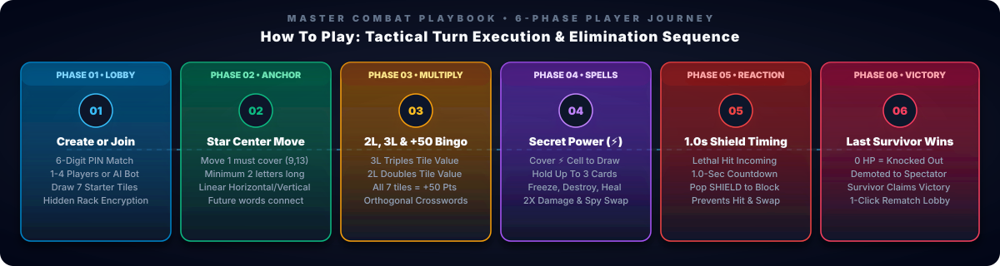
</div>

<br/>

### The 6-Phase Combat Flow

1. **Phase 1 • Lobby & Seat Matchmaking**  
   Create a room or join via a 6-digit Game PIN. The host configures the ruleset (**HP Deathmatch**, **Turn Count**, **Classic**, or **Fancy**), player capacity (1 to 4 players), turn timer (30s to 120s, or unlimited), and AI Bot participants. Each player draws an initial rack of 7 random tournament tiles. Rack contents remain strictly hidden from opponents using end-to-end server verification.

2. **Phase 2 • Opening Move & Center Star Anchor**  
   The first word of the match **must** cover the Center Star coordinate at `(Row 9, Col 13)`. The opening word must contain at least 2 letters placed in a single linear direction (horizontal or vertical). All subsequent words played in the match must connect orthogonally to existing tiles on the board.

3. **Phase 3 • Board Multipliers & 50-Point Bingo**  
   Scoring rewards spatial strategy:
   - **Triple Letter (3L Fire):** Triples the letter score of the newly placed tile.
   - **Double Letter (2L Earth):** Doubles the letter score of the newly placed tile.
   - **Orthogonal Crosswords:** Placed tiles that form secondary perpendicular words score points across all formed words simultaneously.
   - **50-Point All-Tile Bingo:** Placing all 7 tiles from your active rack in a single turn triggers a lethal +50 score bonus and screen-clearing particle shockwave.

4. **Phase 4 • Secret Power Square (⚡) Spells**  
   Placing a letter onto any of the glowing cyan **Secret Power Squares** immediately awards a random tactical Power Card to your hand (maximum 3 cards held). Power Cards can be deployed to block damage, recover health, freeze enemy paths, demolish board tiles, or steal tiles.

5. **Phase 5 • 1.0-Second Reactive Shield Window**  
   When an opponent commits a lethal word attack or activates `SPY_SWAP`, the backend initiates a 1.0-second reaction window (`pending_effect`). During this window, defenders holding a `SHIELD` card can deploy it to deflect the attack completely before damage is deducted.

6. **Phase 6 • Elimination, Spectating & Rematch**  
   In HP combat modes, players who reach 0 HP are eliminated and automatically demoted to Spectator status. The last surviving player wins the match. At game conclusion, any player can click **Play Again** to open a synchronized Rematch Lobby that instantly invites all players into the next battle.

---

## Game Modes & Ruleset Arbitration

<br/>

<!-- Animated Game Modes Graphic -->
<div align="center">
  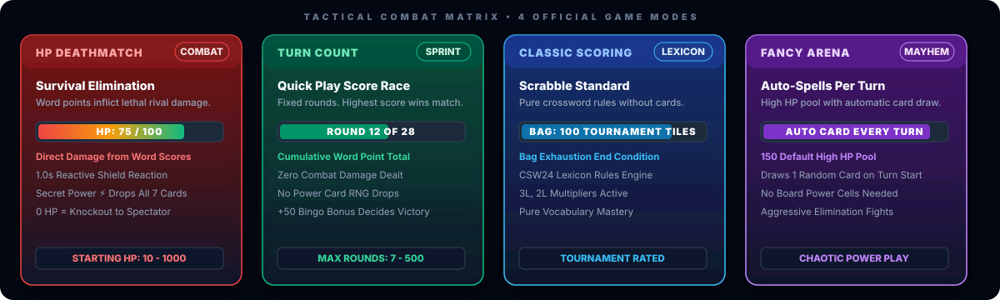
</div>

<br/>

<!-- Match Modes Arbitration Tree SVG -->
<div align="center">
  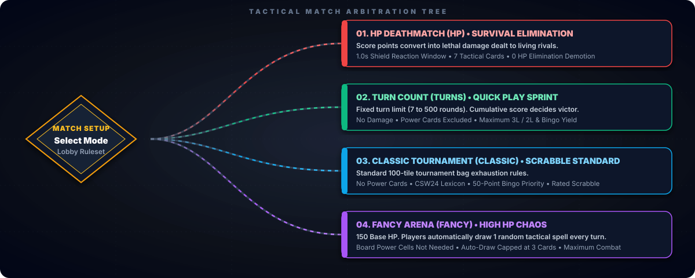
</div>

<br/>

### Detailed Ruleset Matrix

- **HP Deathmatch (`HP`) &bull; Survival Elimination**  
  **Primary Objective:** Deplete rival HP to 0 while defending your own health pool.  
  **Mechanics:** Every point scored from legal words is converted into direct attack damage dealt to living rivals. Features full access to the 7 tactical Power Cards, the 1.0-second Shield reaction window, and configurable starting HP (10 to 1,000 HP, default: 100 HP). Knocked-out players transition to spectators.

- **Turn Count Mode (`TURNS`) &bull; Quick Play Sprint**  
  **Primary Objective:** Maximize cumulative word score within a fixed number of rounds.  
  **Mechanics:** Matches run for a preset round limit (e.g., 7, 14, 21, 28, up to 500 rounds). Word scores do not deal damage, and Power Cards are excluded from board drops to preserve pure Scrabble balance. The player with the highest total score at the end of the final round wins.

- **Classic Tournament (`CLASSIC`) &bull; Scrabble Standard**  
  **Primary Objective:** Traditional tournament crossword victory via bag exhaustion.  
  **Mechanics:** Follows official tournament crossword rules without combat cards or HP mechanics. The game concludes when the 100-tile bag is completely depleted and one player exhausts their entire tile rack, or after 4 consecutive scoreless turns (passes/exchanges). Winner is determined by total score.

- **Fancy Blood Arena (`FANCY`) &bull; High HP Tactical Mayhem**  
  **Primary Objective:** Overcome opponents in an aggressive, card-heavy brawl.  
  **Mechanics:** Players start with a boosted health pool of 150 HP. Instead of hunting for board power squares, **players automatically draw 1 random tactical spell at the start of every turn** (up to the 3-card hand limit). Fast-paced, explosive combat where spells chain every single round.

---

## Tactical Power Card Deck

Players acquire tactical Power Cards by landing tiles onto **Secret Power Squares (`⚡`)** in HP Mode or by turn draw in Fancy Mode (maximum **3 cards** held in hand):

<br/>

<!-- Animated Power Cards Arsenal Graphic -->
<div align="center">
  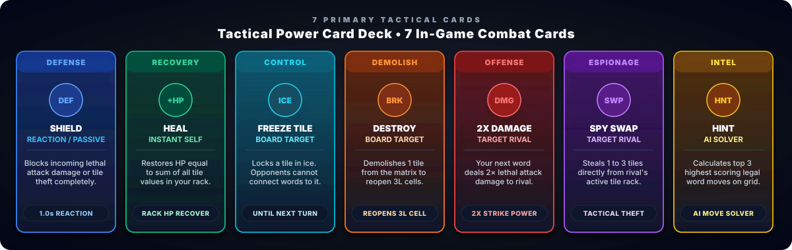
</div>

<br/>

### Official 7-Card Combat Arsenal

- **Shield** (`SHIELD`) &bull; `Reaction / Passive` &bull; `Energy Cost: 0`  
  Automatically deflects incoming lethal attack damage or tile swaps during the 1.0-second reaction window. Must be held in hand prior to the rival attack to trigger.

- **Heal** (`HEAL`) &bull; `Instant Self` &bull; `Energy Cost: 0`  
  Instantly restores health points equal to the combined point sum of all 7 tiles currently resting in your active rack. Maximized when holding high-value consonant tiles (`Q`, `Z`, `J`, `X`).

- **Freeze Tile** (`FREEZE_TILE`) &bull; `Board Coordinate` &bull; `Energy Cost: 0`  
  Encases a targeted matrix tile in crystalline ice armor. Rivals cannot connect words to this frozen tile until your next turn arrives, neutralizing opponent setups.

- **Destroy Tile** (`DESTROY_TILE`) &bull; `Board Coordinate` &bull; `Energy Cost: 0`  
  Demolishes 1 existing letter tile from the board, severing enemy word clusters or reopening high-yield multiplier cells (such as 3L) for your own placement.

- **Double Damage** (`DOUBLE_DAMAGE`) &bull; `Target Rival` &bull; `Energy Cost: 0`  
  Supercharges your next committed word with $2\times$ lethal attack damage directed at a chosen opponent, delivering devastating knockout strikes.

- **Spy Swap** (`SPY_SWAP`) &bull; `Target Rival` &bull; `Energy Cost: 0`  
  Stealthily swaps 1 to 3 designated tiles from your rack with random tiles stolen directly from a chosen opponent's rack, sabotaging their vocabulary combinations.

- **Hint** (`HINT`) &bull; `AI Solver` &bull; `Energy Cost: 0`  
  Activates the backend heuristic solver to compute and highlight the top 3 highest-scoring legal word placements, coordinates, and score projections on the board.

> [!NOTE]
> In **Turn Count Mode (`TURNS`)** and **Classic Tournament (`CLASSIC`)**, combat and HP-specific cards are completely excluded from play to maintain traditional Scrabble integrity.

---

## 19x27 Modular Matrix & Special Squares

<br/>

<!-- Animated Board Radar & Multipliers Graphic -->
<div align="center">
  
</div>

<br/>

<!-- Animated Special Cells SVG -->
<div align="center">
  
</div>

<br/>

<!-- Animated 19x27 Matrix Geometry Blueprint SVG -->
<div align="center">
  
</div>

<br/>

### Matrix Topology & Cell Layout

- **Center Star Anchor &bull; (Row 9, Col 13)**  
  The mandatory origin point for match opening moves. The first word played must cover this coordinate to unlock the rest of the board.

- **Triple Letter (3L Fire) &bull; 8 Symmetrical Cells**  
  Glossy crimson cells that triple the point value of newly placed tiles. Positioned strategically at outer edge corridors: `(0, 13)`, `(18, 13)`, `(1, 2)`, `(1, 24)`, `(17, 2)`, `(17, 24)`, `(8, 0)`, `(8, 26)`, `(10, 0)`, `(10, 26)`, `(9, 10)`, `(9, 16)`.

- **Double Letter (2L Earth) &bull; 12 Symmetrical Cells**  
  Glossy emerald green cells that double the letter value of placed tiles. Serving as stepping stones connecting the center star with outer board corridors.

- **Secret Power Square (⚡ Lightning) &bull; Symmetrical Gem Cells**  
  Neon cyan cells featuring a glowing gold lightning bolt. Landing a tile on any power cell triggers an immediate tactical card drop into the player hand.

---

## Real-Time Multiplayer, AI Bots & Spectating

<br/>

<!-- Animated 5-Step Combat Flow Pipeline -->
<div align="center">
  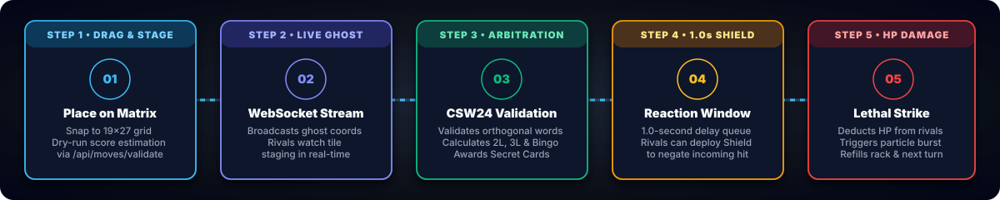
</div>

<br/>

<!-- Combat Sequence Arbitration SVG -->
<div align="center">
  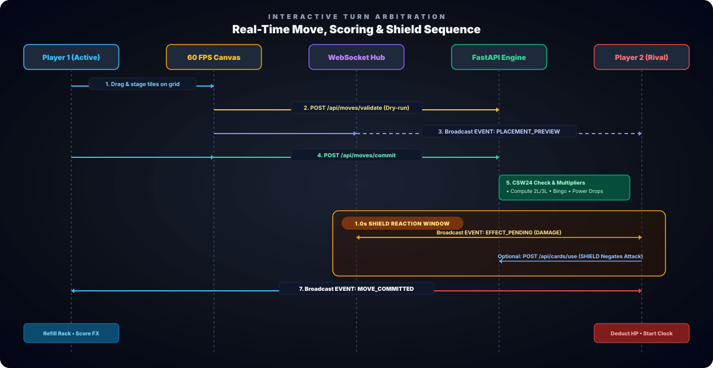
</div>

<br/>

### Multiplayer Capabilities

- **Autonomous AI Bot Opponents (SparkBot, Nexus AI, Titan AI)**  
  Powered by heuristic anagram solvers (`bot_service.py`) using the official CSW24 lexicon. Bots can evaluate thousands of candidate placements per second, execute intelligent tile exchanges, pass turns when constrained, and deploy Power Cards tactically.

- **Live Spectator Mode & Placement Ghosting**  
  Spectators join with zero seat consumption (`?spectate=1`). Spectators and opponents receive real-time translucent placement ghost updates via WebSockets as opponents drag tiles across the canvas, delivering an authentic esports viewing experience.

- **Resilient Reconnection Grace Window**  
  If a player's connection drops (e.g., page refresh or unstable Wi-Fi), the server maintains their active turn and socket state for a 15-second grace window, preventing accidental forfeits.

- **Synchronized 1-Click Rematch Lobbies**  
  Upon match completion, the Game Over screen displays a synchronized Rematch Lobby. When the first player clicks **Play Again**, a new room is instantiated and its PIN is broadcast via WebSockets to all participants, preserving match continuity.

---

## System Architecture

<br/>

<!-- Animated System Architecture SVG -->
<div align="center">
  
</div>

<br/>

### Architecture Breakdown

- **Frontend Client Tier (Next.js 16 + React 19):**  
  Delivers a high-DPI HTML5 Canvas 2D engine with double-buffered bitmap caching, procedural Web Audio SFX, responsive Tailwind CSS 4 interfaces, and pure WebSocket subscriptions.
- **Backend Application Tier (FastAPI + Python 3.12):**  
  Authoritative rules validation, CSW24 lexicon lookup, heuristic AI bot executors, 1.0s shield delay queue, and asynchronous WebSocket broadcast hubs.
- **Persistence Tier (PostgreSQL 16 & SQLite):**  
  Zero-config embedded SQLite for instant local development, with seamless automated switching to PostgreSQL connection pools for Docker Compose and production cloud hosting.

---

## Database Entity-Relationship Model

<br/>

<!-- Database Entity Relationship Diagram SVG -->
<div align="center">
  
</div>

<br/>

---

## Project Directory Tree

```
crossword-game/
├── backend/                                # FastAPI Python 3.12 Backend
│   ├── app/
│   │   ├── api/                            # REST API Endpoints
│   │   │   ├── cards.py                    # Power Card activation & effect resolution
│   │   │   ├── debug.py                    # God-mode testing & multi-player simulation
│   │   │   ├── dictionary.py               # Word definition & phonetics lookup
│   │   │   ├── games.py                    # Game lifecycle, pass, exchange, rematch & bot
│   │   │   ├── history.py                  # Move & card usage history queries
│   │   │   ├── moves.py                    # Tile placement, validation & turn commit
│   │   │   └── rooms.py                    # Lobby management, PIN join & settings
│   │   ├── core/                           # Configuration, security & constants
│   │   ├── database/                       # SQLAlchemy Async models, state & connection pool
│   │   ├── game/                           # Core crossword game logic
│   │   │   ├── board.py                    # 19x27 Board definitions, multipliers & mirror logic
│   │   │   ├── dictionary.py               # CSW24 tournament wordlist loader & indexer
│   │   │   ├── extractor.py                # Orthogonal 2D word extraction
│   │   │   ├── game_end.py                 # Victory conditions & pass exhaustion
│   │   │   ├── grimoire.py                 # Positional anagram word solver & cache
│   │   │   ├── hint.py                     # AI word candidate generator & hint solver
│   │   │   ├── offline_definitions.py      # Pre-seeded offline word definitions
│   │   │   ├── rules.py                    # Legal placement & connectivity verification
│   │   │   ├── scoring.py                  # Score calculation & 50-point Bingo bonus
│   │   │   └── tiles.py                    # Tile bag distribution & exchange logic
│   │   ├── schemas/                        # Pydantic request/response & WebSocket event models
│   │   ├── services/                       # Business logic services
│   │   │   ├── bot_service.py              # AI Bot planning & automated turn execution
│   │   │   ├── dictionary_lookup.py        # 3-tier L1/L2/L3 definition lookup service
│   │   │   ├── game_service.py             # Match turns, timeouts, rematch & state assembly
│   │   │   ├── move_service.py             # Authoritative move commitment & combat damage
│   │   │   └── room_service.py             # Room lifecycle, expiration & rematch lobbies
│   │   └── websocket/                      # Real-time WebSocket connection manager & handlers
│   ├── data/
│   │   └── wordlist.txt                    # Tournament lexicon database (CSW24)
│   ├── tests/                              # Automated Pytest test suites (138+ passed)
│   ├── Dockerfile                          # Backend container definition
│   ├── main.py                             # FastAPI entrypoint, lifespan & CORS
│   └── requirements.txt                    # Python dependencies
│
├── frontend/                               # Next.js 16 + React 19 Client
│   ├── app/                                # Next.js App Router pages
│   │   ├── bot/page.tsx                    # Solo AI Bot match creation & difficulty setup
│   │   ├── game/[gameId]/page.tsx          # Real-time multiplayer game arena & HUD
│   │   ├── lobby/[pin]/page.tsx            # Room lobby, player readiness & rematch
│   │   ├── layout.tsx                      # Root layout & font configurations
│   │   └── page.tsx                        # Main landing hub, room browser & modal guides
│   ├── components/
│   │   ├── audio/                          # BackgroundMusic & synthesized sound effects
│   │   ├── board/                          # HTML5 Canvas 2D Board Engine
│   │   │   ├── BoardCanvas.tsx             # Canvas host, viewport resizing & pointer events
│   │   │   ├── PremiumCellOverlay.tsx      # CSS 3D transformed multiplier badges & echoes
│   │   │   └── engine/
│   │   │       ├── BoardCompositor.ts      # Multi-layer rAF animation loop & frustum culling
│   │   │       ├── FXRenderer.ts           # Placement shockwaves, glow trails & floating text
│   │   │       ├── GridRenderer.ts         # Double-buffered offscreen cached grid background
│   │   │       └── TileRenderer.ts         # Beveled wood tiles, typography & freeze shaders
│   │   ├── debug/                          # DebugPanel god-mode session switcher
│   │   ├── game/                           # GameHUD, RightSidebar, TurnBanner, PowerCardBar
│   │   ├── lobby/                          # PlayerList, LobbyCard, RoomSettings
│   │   ├── notification/                   # EnableNotify permission request component
│   │   ├── rack/                           # TileRack, FloatingTile, DragPortal
│   │   └── ui/                             # CustomSelect, FullscreenButton, Modal
│   ├── hooks/                              # useBoardCamera, useTileDrag, useStagedMove, useGameSync
│   ├── lib/                                # API client, types, tile configurations & audio
│   ├── server.js                           # Custom Node server (Next.js + /api & /ws reverse proxy)
│   ├── package.json                        # Frontend dependencies & scripts
│   └── tailwind.config.ts                  # Tailwind CSS 4 styling configuration
│
├── docs/                                   # Documentation & Animated Assets
│   ├── assets/                             # 17 Animated SVGs (Hero, Bento, Modes, Cards, Radar, Flow, Arch)
│   └── TEST_SCENARIOS.md                   # Complete test scenarios and edge-case matrix
├── gateway/                                # Nginx gateway configuration
│   └── nginx.conf                          # Reverse proxy routing for frontend & backend
├── docker-compose.yml                      # Full 5-service container stack orchestration
├── render.yaml                             # Cloud deployment configuration for Render
└── README.md                               # Project documentation
```

---

## Quick Start & Installation

<br/>

<!-- Animated Quick Start & Runtime Deployment Banner SVG -->
<div align="center">
  
</div>

<br/>

### Option 1: Docker Compose (Full Stack Orchestration)

Launch the complete container stack (**Frontend**, **Backend**, **PostgreSQL**, **Nginx Gateway**, **Adminer**, and **Ngrok tunnel**):

```bash
# 1. Clone repository & enter workspace
git clone https://github.com/Cell1991/crossword-game.git
cd crossword-game

# 2. Copy environment template
cp .env.example .env

# 3. Launch full stack with live reload
docker compose up --build
```

#### Active Service Ports & Endpoints
- **Web Client** &bull; `Port 3000` &bull; [http://localhost:3000](http://localhost:3000)  
  Next.js 16 Client & Canvas 2D Engine *(Gateway: [http://localhost:8090](http://localhost:8090))*
- **API Docs (Swagger)** &bull; `Port 8000` &bull; [http://localhost:8000/docs](http://localhost:8000/docs)  
  Interactive OpenAPI / Swagger Documentation & Live Testing
- **Database Adminer** &bull; `Port 8085` &bull; [http://localhost:8085](http://localhost:8085)  
  PostgreSQL Web GUI Management & Table Inspector
- **Ngrok Tunnel** &bull; `Port 4040` &bull; [http://localhost:4040](http://localhost:4040)  
  Live Public Webhook & Remote Multiplayer Inspection

---

### Option 2: Local Development (Zero-Config SQLite)

Run the backend and frontend locally without installing PostgreSQL. The backend automatically initializes an embedded **SQLite** database (`crossword.db`) and pre-seeds the CSW24 tournament lexicon.

```bash
# 1. BACKEND SETUP (FastAPI)
cd backend
python -m venv venv

# Windows (PowerShell):
.\venv\Scripts\Activate.ps1
# Linux / macOS:
source venv/bin/activate

pip install -r requirements.txt
uvicorn main:app --host 0.0.0.0 --port 8000 --reload
```

```bash
# 2. FRONTEND SETUP (Next.js 16)
cd frontend
npm install
npm run dev
```

> [!TIP]
> Once launched, open **[http://localhost:3000](http://localhost:3000)** to enter the Arena lobby.

---

## API & WebSocket Specification

### REST API Endpoints

#### Room & Lobby Management (`/api/rooms`)
- `GET /api/rooms` &mdash; Retrieve a list of active public rooms waiting for players.
- `POST /api/rooms` &mdash; Create a new room with game mode (`HP`, `TURNS`, `CLASSIC`, `FANCY`), timer limits, and player capacity.
- `GET /api/rooms/{game_pin}` &mdash; Get room lobby details, joined players, and spectator counts.
- `PATCH /api/rooms/{game_pin}` &mdash; Update room settings (host only: max players, turn time limits).
- `POST /api/rooms/{game_pin}/join` &mdash; Join a room using its 6-digit Game PIN.
- `POST /api/rooms/{game_pin}/leave` &mdash; Leave a room lobby.
- `POST /api/rooms/{game_pin}/start` &mdash; Start the game match (host only).

#### Game & Move Actions (`/api/games` & `/api/moves`)
- `GET /api/games/{game_id}` &mdash; Fetch current authoritative game state, player HP, scores, and board state.
- `POST /api/moves/validate` &mdash; Dry-run validation of provisional placed tiles without committing turn.
- `POST /api/moves/commit` &mdash; Commit a move, calculate multipliers, apply Bingo bonus, and deal damage.
- `POST /api/games/{game_id}/pass` &mdash; Pass turn to the next eligible player (4 consecutive passes end match).
- `POST /api/games/{game_id}/exchange` &mdash; Exchange rack tiles with the tile bag (requires $\ge 7$ bag tiles).
- `POST /api/games/{game_id}/timeout` &mdash; Advance turn when countdown timer expires.
- `POST /api/games/{game_id}/effects/resolve` &mdash; Finalize pending attack damage or tile swaps after the shield reaction window.
- `POST /api/games/{game_id}/rematch` &mdash; Create or join a synchronized rematch lobby following game completion.
- `POST /api/games/{game_id}/bot/plan` &mdash; Plan AI bot move based on rack, difficulty, and board state.
- `POST /api/games/{game_id}/bot/execute` &mdash; Commit a planned AI bot move, exchange, or pass.

#### Tactical Power Cards (`/api/games/{game_id}/cards`)
- `POST /api/games/{game_id}/cards/use` &mdash; Deploy a held Power Card (`SHIELD`, `HEAL`, `FREEZE_TILE`, `DESTROY_TILE`, `DOUBLE_DAMAGE`, `SPY_SWAP`, `HINT`).

#### Dictionary & Definitions (`/api/dictionary`)
- `GET /api/dictionary/{word}` &mdash; Query word definitions, phonetic transcriptions, and meanings (L1 RAM &rarr; L2 Database &rarr; L3 API).

---

### WebSocket Real-Time Events (`/ws/games/{game_id}`)

Clients establish a persistent real-time connection with heartbeat ping/pong support:
```text
ws://localhost:3000/ws/games/{game_id}?token={session_token}
```

#### Core Event Types
- `PLAYER_JOINED` / `PLAYER_LEFT`: Real-time lobby seat occupancy updates.
- `PLAYER_RECONNECTED` / `PLAYER_DISCONNECTED`: Connection state tracking (15-second grace period).
- `GAME_STARTED`: Signals match initialization and hands out starting tile racks.
- `PLACEMENT_PREVIEW`: Broadcasts translucent placement ghost tiles of active opponents.
- `MOVE_COMMITTED`: Synchronizes committed board tiles, formed words, and damage dealt.
- `TURN_PASSED` / `TILES_EXCHANGED`: Turn advance notification.
- `EFFECT_PENDING`: Alerts opponents to incoming attacks and starts the 1.0-second Shield window.
- `EFFECT_RESOLVED`: Confirms damage inflicted, blocked, or tile swaps completed.
- `CARD_USED`: Broadcasts tactical card activations to all players.
- `GAME_ENDED`: Match conclusion, final scoreboard, and victory declaration.
- `REMATCH_CREATED`: Invites all participants into a newly spawned rematch lobby.

---

## Testing & Verification

<br/>

<!-- Animated Testing Suite & Verification Matrix SVG -->
<div align="center">
  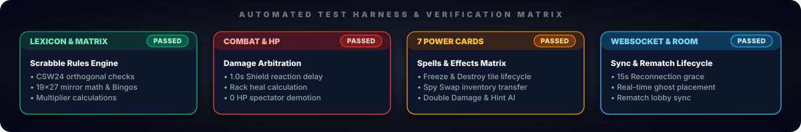
</div>

<br/>

Execute the automated Pytest harness covering Scrabble compliance, damage mitigation, and card states:

```bash
cd backend

# Windows PowerShell:
$env:PYTHONPATH="." ; pytest tests/ -v

# Linux / macOS:
PYTHONPATH=. pytest tests/ -v
```

---

## Contributors & Development Team

<br/>

<!-- Animated Core Development Crew SVG with Embedded Base64 Avatars -->
<div align="center">
  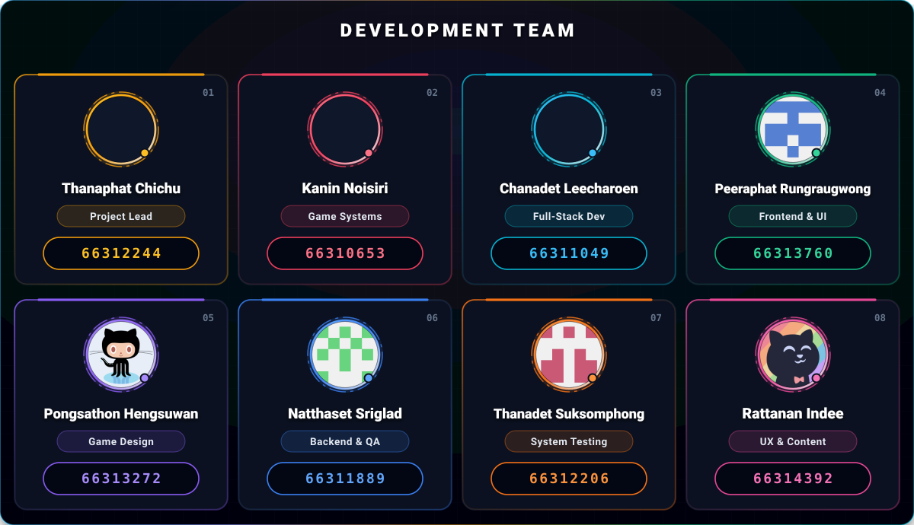
</div>

<br/>

<p align="center">
  <a href="https://github.com/Cell1991"></a>
  <a href="https://github.com/friend47"></a>
  <a href="https://github.com/waiwaix43"></a>
  <a href="https://github.com/Natthaset2547"></a>
  <a href="https://github.com/Rednoselittledog"></a>
  <a href="https://github.com/ReFresh-bit"></a>
</p>

---

## License

This project is open source and available under the **[MIT License](LICENSE)**.

<div align="center">
  <sub>Crafted with passion for competitive word puzzle combat and real-time tactical multiplayer gaming.</sub>
</div>
